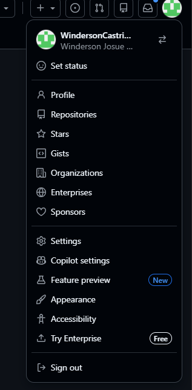
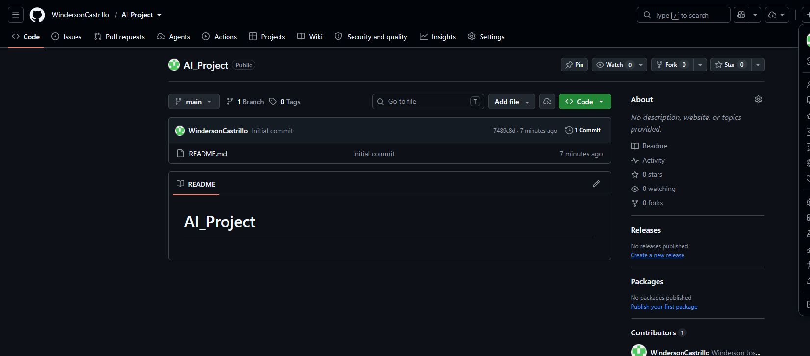
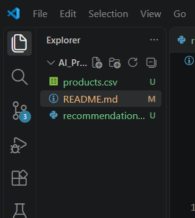
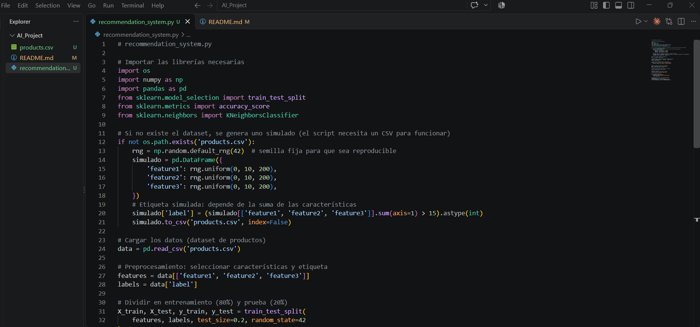
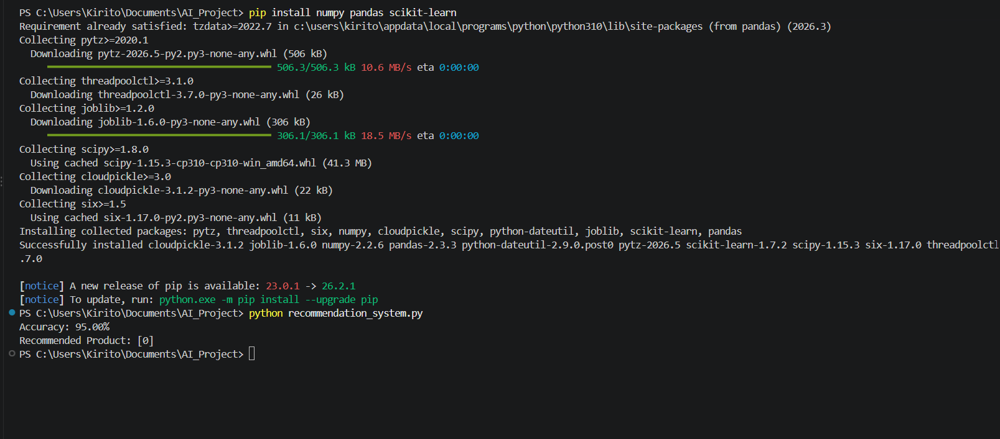
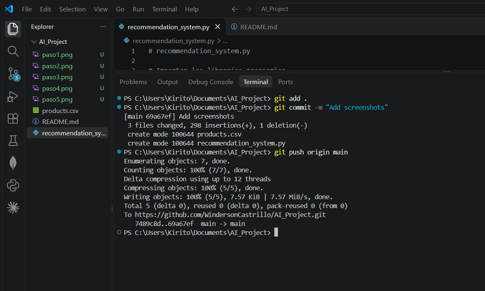

# AI_Project

## Objetivo
Explorar tendencias emergentes en inteligencia artificial utilizando GitHub Copilot como herramienta práctica.

## Proceso realizado

### 1. Obtención de la cuenta en GitHub Copilot
Ingresé a https://github.com/ con mi cuenta institucional y accedí a GitHub Copilot.



### 2. Creación del repositorio
Creé un repositorio público llamado `AI_Project` con un archivo README.



### 3. Clonación del repositorio
Abrí Visual Studio Code y cloné el repositorio desde el terminal integrado:

```
git clone https://github.com/WindersonCastrillo/AI_Project.git
cd AI_Project
```



### 4. Creación de `recommendation_system.py` con Copilot
Creé el archivo y usé GitHub Copilot para generar un sistema de recomendación basado en KNN (scikit-learn), con división entrenamiento/prueba (80/20), evaluación de accuracy y una función `recommend()`.



### 5. Ejecución del script
Instalé las dependencias (`pip install numpy pandas scikit-learn`) y ejecuté el script. Resultado: Accuracy de 95.00% y una recomendación para el producto de ejemplo.



### 6. Commit y push
Subí los cambios a GitHub con los siguientes comandos:

```
git add .
git commit -m "Add recommendation system example"
git push origin main
```

